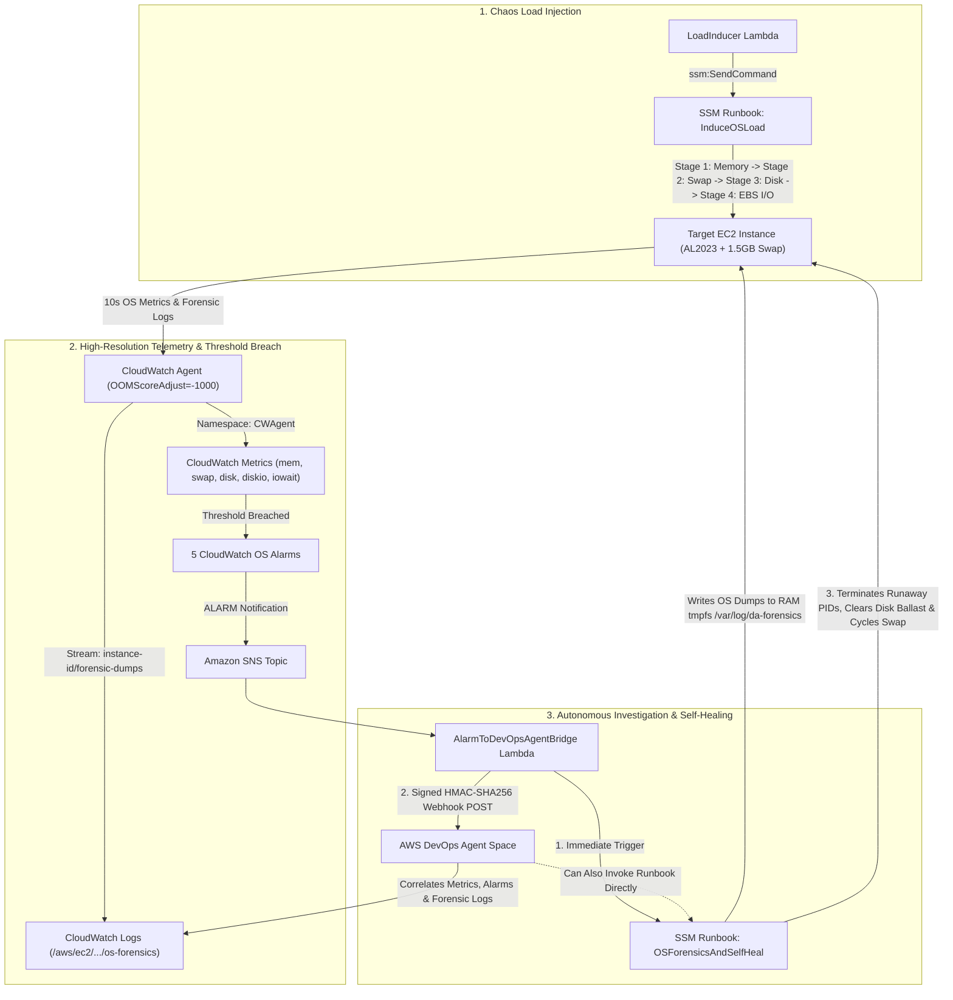

# AWS DevOps Agent Autonomous Investigation & Self-Healing EC2 Testbed

[](./cloudformation/da-auto-investigation-stack.yaml)
[](./cloudshell-install.sh)
[](./cloudformation/da-auto-investigation-stack.yaml)
[](./LICENSE)

An end-to-end **Chaos Engineering, Autonomous Investigation, and Self-Healing EC2 Testbed** designed for **AWS DevOps Agent** and **AWS CloudShell**.

This project provisions an Amazon EC2 instance with the CloudWatch Agent and OS-level stall protection, induces progressive operating system exhaustion (**Memory $\rightarrow$ Swap $\rightarrow$ Disk Space $\rightarrow$ EBS Throughput & I/O**), automatically captures deep kernel/process forensic dumps into CloudWatch Logs via AWS Systems Manager (SSM) when thresholds breach, triggers **AWS DevOps Agent** via signed HMAC-SHA256 webhooks for autonomous root-cause investigation, and self-heals the instance.

---

## Table of Contents

- [Architecture Overview](#architecture-overview)
- [Key Capabilities](#key-capabilities)
- [Repository Structure](#repository-structure)
- [1-Minute Install in AWS CloudShell](#1-minute-install-in-aws-cloudshell)
- [Inducing OS Load (Chaos Scenarios)](#inducing-os-load-chaos-scenarios)
- [CloudWatch Alarms & Thresholds](#cloudwatch-alarms--thresholds)
- [Observing Forensic Dumps & Self-Healing](#observing-forensic-dumps--self-healing)
- [Configuration Parameters](#configuration-parameters)
- [Cleanup & Teardown](#cleanup--teardown)

---

## Architecture Overview



---

## Key Capabilities

- **Progressive 4-Stage Load Inducer Lambda (`LoadInducer`)**:
  - **Stage 1 — Physical Memory Exhaustion (`memory`)**: Uses `stress-ng --vm` to allocate ~86% of physical RAM.
  - **Stage 2 — Swap Exhaustion (`swap`)**: Allocates 92% of RAM + 65% of the 1.5 GB swap file (`vm.swappiness=80`) to force heavy swap paging.
  - **Stage 3 — Disk Space Exhaustion (`disk_space`)**: Uses `fallocate`/`dd` to write `/var/tmp/da-disk-ballast.img` until root filesystem utilization exceeds 90%.
  - **Stage 4 — EBS Throughput & IOPS Saturation (`ebs_io`)**: Uses `fio` with `O_DIRECT`, `libaio`, and `iodepth=64` to saturate EBS bandwidth and IOPS.
  - **Chained Mode (`chained`)**: Automatically executes Stage 1 $\rightarrow$ Stage 2 $\rightarrow$ Stage 3 $\rightarrow$ Stage 4 sequentially.
- **OS Stall Protection (Survives 100% Disk Full & OOM)**:
  - Mounts `/var/log/da-forensics` as a **64 MB RAM-backed `tmpfs`** so SSM forensic dumps and CloudWatch Agent log streaming never fail with `ENOSPC` when `/` is 100% full or EBS I/O is stalled.
  - Applies `systemd` overrides (`OOMScoreAdjust=-1000`, `Nice=-15`, `CPUWeight=10000`, `IOWeight=10000`, `IOSchedulingClass=realtime`) to `amazon-ssm-agent` and `amazon-cloudwatch-agent`.
- **Automated SSM Forensic Dump & Self-Healing (`OSForensicsAndSelfHeal`)**:
  - Captures Linux Pressure Stall Information (`/proc/pressure/*`), `free -m`, `/proc/meminfo`, top 15 memory/CPU PIDs, top 10 swap PIDs (`VmSwap`), uninterruptible `D`-state processes, largest ballast files, `lsof +L1` deleted open files, `iostat -xz`, `pidstat -d`, and `dmesg` OOM logs into CloudWatch Logs.
  - Automatically terminates runaway load processes, removes disk ballast files, drops caches, and resets swap after `SelfHealDelaySeconds` (default `30s`).
- **AWS DevOps Agent Webhook Integration (`AlarmToDevOpsAgentBridge`)**:
  - Formats CloudWatch alarm breaches into the official AWS DevOps Agent incident schema, signs payloads with **HMAC-SHA256** (`x-amzn-event-timestamp` and `x-amzn-event-signature`), and attaches the exact CloudWatch Log Group, stream name, and SSM `CommandId` for instant root-cause correlation.

---

## Repository Structure

```text
├── cloudformation/
│   └── da-auto-investigation-stack.yaml   # Complete CloudFormation template (EC2, SSM, Lambdas, Alarms, SNS, IAM)
├── scripts/
│   ├── deploy.sh                          # Bash deployer (auto-discovers VPC/Subnet & AWS_DevOps_Agent_Role)
│   ├── deploy.ps1                         # PowerShell deployer for Windows
│   ├── trigger-load.sh                    # Bash CLI helper to invoke LoadInducer Lambda
│   ├── trigger-load.ps1                   # PowerShell helper to invoke LoadInducer Lambda
│   └── cleanup.sh                         # Clean stack teardown script
├── docs/
│   ├── DEVOPS-AGENT-WEBHOOK-SPEC.md       # Webhook payload schema & HMAC-SHA256 signing specification
│   └── FORENSICS-AND-SELF-HEALING.md      # Deep-dive on tmpfs stall protection & forensic dump sections
├── cloudshell-install.sh                  # Single-file standalone installer for AWS CloudShell
└── README.md
```

---

## 1-Minute Install in AWS CloudShell

Open **AWS CloudShell** in your AWS Console and run:

### Option A: Clone from GitHub (Recommended)

```bash
git clone https://github.com/<your-github-org>/da-auto-investigation.git
cd da-auto-investigation

export DEVOPS_AGENT_WEBHOOK_URL="https://<your-devops-agent-webhook-url>"
export DEVOPS_AGENT_WEBHOOK_SECRET="<your-webhook-hmac-secret>"

chmod +x scripts/*.sh
./scripts/deploy.sh
```

### Option B: Single-File Upload (`cloudshell-install.sh`)

1. In AWS CloudShell, click **Actions** $\rightarrow$ **Upload file** and select `cloudshell-install.sh`.
2. Run:
   ```bash
   chmod +x ~/cloudshell-install.sh
   export DEVOPS_AGENT_WEBHOOK_URL="https://<your-devops-agent-webhook-url>"
   export DEVOPS_AGENT_WEBHOOK_SECRET="<your-webhook-hmac-secret>"
   ~/cloudshell-install.sh
   ```

> [!TIP]
> **Dry-Run Support**: If you deploy without setting `DEVOPS_AGENT_WEBHOOK_URL`, the stack deploys cleanly using a placeholder URL and logs the signed HMAC incident payloads to CloudWatch Logs. You can update the live webhook URL anytime in **AWS Secrets Manager** (`da-auto-investigation-devops-agent-webhook`).

---

## Inducing OS Load (Chaos Scenarios)

Use `./scripts/trigger-load.sh` (or `~/da-auto-investigation/trigger-load.sh` if installed via `cloudshell-install.sh`):

```bash
# 1. Full 4-Stage Chained Sequence (Memory -> Swap -> Disk Space -> EBS I/O, 90s per stage)
./scripts/trigger-load.sh chained 90

# 2. Individual Stage Tests
./scripts/trigger-load.sh memory 120       # Exhaust physical RAM (~86%)
./scripts/trigger-load.sh swap 120         # Exhaust RAM + Swap (>50% swap)
./scripts/trigger-load.sh disk_space 120   # Fill root filesystem (>90% /)
./scripts/trigger-load.sh ebs_io 120       # Saturate EBS IOPS & Throughput (fio O_DIRECT)

# 3. Stop All Load & Clean Up Immediately
./scripts/trigger-load.sh stop
```

Or invoke the Lambda directly via AWS CLI:

```bash
aws lambda invoke \
  --function-name da-auto-investigation-LoadInducer \
  --cli-binary-format raw-in-base64-out \
  --payload '{"mode": "chained", "duration_seconds": 90}' \
  /tmp/response.json && cat /tmp/response.json
```

---

## CloudWatch Anomaly Detection Alarms

Instead of hardcoded static thresholds, all 5 alarms use **Amazon CloudWatch Anomaly Detection** (`AWS::CloudWatch::AnomalyDetector` + `ANOMALY_DETECTION_BAND(m1, <StdDevs>)` with `ComparisonOperator: GreaterThanUpperThreshold`). Each metric is published under the `CWAgent` namespace at **10-second** resolution and evaluated every **60 seconds** against its learned upper anomaly band:

| Alarm Name | Metric (`CWAgent`) | Anomaly Detection Expression | Triggered Load Stage | Breach Category Passed to SSM & DevOps Agent |
| :--- | :--- | :--- | :--- | :--- |
| `<stack>-1-MemoryAnomalyAlarm` | `mem_used_percent` (`Average`) | `GreaterThanUpperThreshold` (`ANOMALY_DETECTION_BAND(m1, 2)`) | Stage 1 (`memory`) | `MEMORY` |
| `<stack>-2-SwapAnomalyAlarm` | `swap_used_percent` (`Average`) | `GreaterThanUpperThreshold` (`ANOMALY_DETECTION_BAND(m1, 2)`) | Stage 2 (`swap`) | `SWAP` |
| `<stack>-3-DiskSpaceAnomalyAlarm` | `disk_used_percent` (`Average`) | `GreaterThanUpperThreshold` (`ANOMALY_DETECTION_BAND(m1, 2)`) | Stage 3 (`disk_space`) | `DISK_SPACE` |
| `<stack>-4-EBSIOSaturationAnomalyAlarm` | `diskio_io_time` (`Sum`) | `GreaterThanUpperThreshold` (`ANOMALY_DETECTION_BAND(m1, 2)`) | Stage 4 (`ebs_io`) | `EBS_IO` |
| `<stack>-5-CPUIoWaitAnomalyAlarm` | `cpu_usage_iowait` (`Average`) | `GreaterThanUpperThreshold` (`ANOMALY_DETECTION_BAND(m1, 2)`) | Stage 2 & Stage 4 | `EBS_IO` |

---

## Automatic Streaming of OS Forensic Dumps & Self-Healing Output to CloudWatch Logs

All operating system forensic dumps, load injection logs, and self-healing remediation outputs are **automatically streamed in real time from the EC2 instance into Amazon CloudWatch Logs** under Log Group:

- **CloudWatch Log Group**: `/aws/ec2/da-auto-investigation/os-forensics`
  - **Stream `{instance_id}/forensic-dumps`**: Shipped continuously by the on-box **CloudWatch Agent** from the RAM-backed `tmpfs` file `/var/log/da-forensics/forensics.log` (`force_flush_interval: 5s`).
  - **Stream `{instance_id}/load-generator`**: Shipped by the **CloudWatch Agent** from `/var/log/da-forensics/load-generator.log`.
  - **SSM Run Command Direct Output Streams**: Every `ssm:SendCommand` invocation (`OSForensicsAndSelfHeal` and `InduceOSLoad`) also enables `CloudWatchOutputConfig` to stream `stdout`/`stderr` directly into `/aws/ec2/da-auto-investigation/os-forensics`.

When an anomaly alarm fires, the `AlarmToDevOpsAgentBridge` Lambda includes this CloudWatch Log Group and stream name in the signed webhook payload so the **AWS DevOps Agent** automatically queries CloudWatch Logs during its root-cause investigation.

### Example Forensic Log Stream Output in CloudWatch Logs (`{instance_id}/forensic-dumps`)

```text
================================================================================
[FORENSIC_DUMP_START] timestamp=2026-10-29T18:06:42Z incident_id=ec2-i-0abc12345def67890-memory-1761742000 alarm=da-auto-investigation-1-HighMemoryUtilization breach_type=MEMORY
================================================================================
--- [1. SYSTEM UPTIME, LOAD AVERAGE & KERNEL PRESSURE] ---
PSI Memory: some avg10=42.15 avg60=18.40 avg300=4.12 total=12450200 full avg10=19.80 avg60=7.20 avg300=1.50 total=5820100
--- [3. TOP 15 MEMORY-CONSUMING PROCESSES] ---
    PID    PPID USER     %MEM %CPU   RSS    VSZ STAT COMMAND         ARGS
   3812    3810 root     43.1 48.2 1724100 1765200 R stress-ng-vm    stress-ng --vm 2 --vm-bytes 3380M --vm-keep --vm-populate --timeout 90s
   3813    3810 root     43.0 47.9 1720800 1765200 R stress-ng-vm    stress-ng --vm 2 --vm-bytes 3380M --vm-keep --vm-populate --timeout 90s
[FORENSIC_DUMP_COMPLETE] timestamp=2026-10-29T18:06:46Z incident_id=ec2-i-0abc12345def67890-memory-1761742000
[SELF_HEALING_SCHEDULED] Waiting 30s before remediating MEMORY so metrics & forensics flush...
================================================================================
[SELF_HEALING_START] timestamp=2026-10-29T18:07:16Z incident_id=ec2-i-0abc12345def67890-memory-1761742000 breach_type=MEMORY
================================================================================
Terminated runaway stress-ng processes.
Cleaned up disk ballast and I/O scratch files in /var/tmp and /tmp.
[SELF_HEALING_COMPLETE] timestamp=2026-10-29T18:07:18Z incident_id=ec2-i-0abc12345def67890-memory-1761742000 status=RECOVERED
```

---

## Configuration Parameters

You can override any parameter via environment variables when running `./scripts/deploy.sh`:

| Environment Variable | CloudFormation Parameter | Default | Description |
| :--- | :--- | :--- | :--- |
| `STACK_NAME` | — | `da-auto-investigation` | CloudFormation stack name |
| `INSTANCE_TYPE` | `InstanceType` | `t3.medium` | Target EC2 instance size (`t3.small`, `t3.medium`, `t3.large`, `m6i.large`) |
| `DEVOPS_AGENT_WEBHOOK_URL` | `DevOpsAgentWebhookUrl` | Placeholder URL | AWS DevOps Agent Space Incoming Webhook URL |
| `DEVOPS_AGENT_WEBHOOK_SECRET` | `DevOpsAgentWebhookSecret` | Placeholder Secret | HMAC-SHA256 secret for signing webhook requests |
| `DEVOPS_AGENT_ROLE_NAME` | `DevOpsAgentRoleName` | `AWS_DevOps_Agent_Role` | Existing DevOps Agent IAM role in the account |
| `ENABLE_SELF_HEALING` | `EnableAutoSelfHealing` | `true` | Automatically remediate runaway processes after dumping forensics |
| `ANOMALY_BAND_WIDTH` | `AnomalyDetectionBandWidth` | `2` | Standard deviations (`1`–`10`) for `ANOMALY_DETECTION_BAND(m1, stdDevs)` |

---

## Cleanup & Teardown

To delete all resources created by the stack:

```bash
./scripts/cleanup.sh
```
